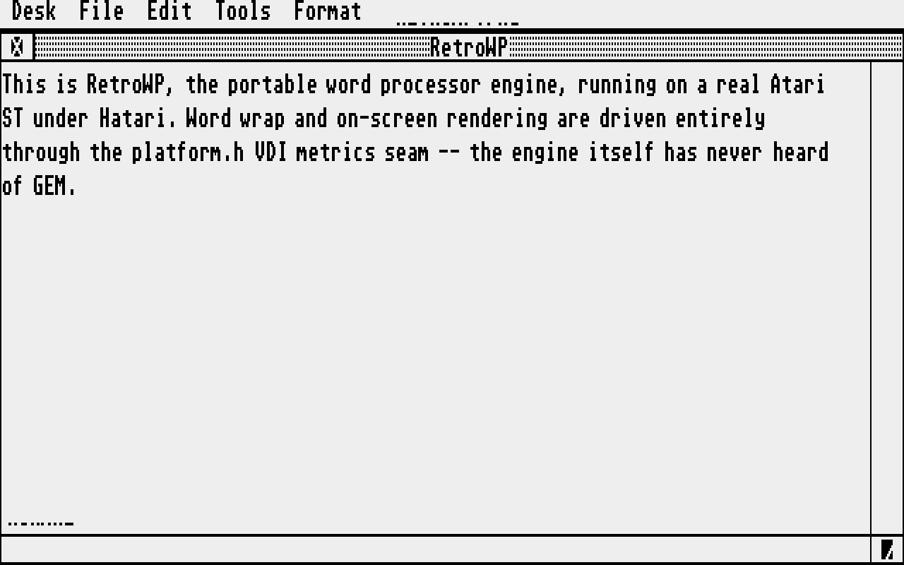
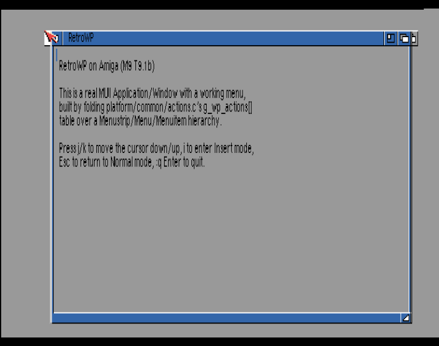
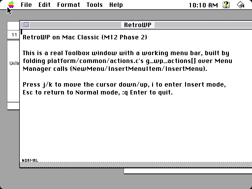
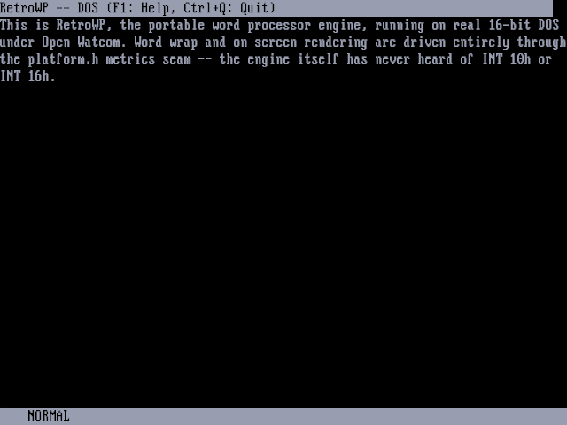

# RetroWP

An open-source, portable word processor for vintage platforms, built around
a single, platform-independent document model written in strict, portable
C89. One engine, one document model, four real vintage backends — no
per-platform forks of the logic, ever.

**Primary target:** Atari ST (1MB, plain TOS).
**Also runs on:** Amiga (MUI), Mac Classic (Toolbox/QuickDraw), and DOS
(text-mode, Open Watcom).

A companion "offload" service (Raspberry Pi + local LLM, or any modern
machine) handles heavy features — grammar checking, large-dictionary
spelling, thesaurus, ODT/PDF conversion, image downconversion — over a
serial/TCP link, so the low-RAM machines stay lean and every feature still
works standalone when nothing is attached.

## Screenshots

Real emulator captures of the actual `RETROWP` binary — not a mockup, not
the smoke-test harness — on all four shipping backends:

| Atari ST (Hatari) | Amiga (amiberry) |
| --- | --- |
|  |  |

| Mac Classic (BasiliskII) | DOS (DOSBox) |
| --- | --- |
|  |  |

## Why

Every vintage word processor for these machines was written from scratch,
once, for that machine. RetroWP instead has exactly one document model,
one editing engine, one layout engine, one set of format importers/
exporters — and four thin platform backends that each implement a small,
frozen `platform.h` seam (fonts, drawing, files, clipboard, timer,
transport). Porting to a new machine means writing that seam, not
re-deriving word wrap.

## Prime Directives

These rules (from `CLAUDE.md`) are non-negotiable and enforced by the
build itself, not just convention:

1. **The engine contains zero platform calls.** No GEM, no MUI, no
   Toolbox, no DOS. It talks to the outside world only through
   `platform.h`.
2. **The internal document model is the single source of truth.** Every
   format (plaintext, RTF, ODT, PDF) is an importer/exporter around it.
3. **Never dump raw structs to disk or the wire.** All persistence and
   protocol messages use explicit, defined byte order (big-endian).
4. **Font metrics are reached only through the metrics abstraction.**
   Layout code never calls a platform font API directly.
5. **The 1MB Atari ST plain-TOS build is the baseline.** A feature that
   can't degrade gracefully at 1MB is tiered (RAM-gated) or offloaded,
   never assumed.
6. **Everything in the engine builds and unit-tests on a modern host**
   with a stub platform backend. Off-target testing is first-class.

`platform/common/` (shared UI scaffolding — action registry, app context,
status line, help viewer) is compiled by *every* target's own toolchain,
including the host. A stray native `#include` in that directory breaks
the host build immediately, since no such header exists there — the rule
is structural, not just documented.

## Status

Every milestone through **M15 (image support)** is complete: document
model, editing, layout/pagination, all four platform backends, five
switchable keybinding schemes (vi, Emacs, WordStar, WordPerfect, MS
Word–style), find & replace, RTF/ODT/PDF/TXT import-export, offload
transport with grammar/spell/thesaurus/chat/image ops, and real (or
honestly placeholder) image rendering on every backend. See
[`docs/milestones.md`](docs/milestones.md) for the full history.

Released (binaries in the [v0.15.0 release](https://github.com/slaapliedje/retrowp/releases/tag/v0.15.0)):
the Atari ST, Amiga, Mac Classic and DOS. In progress: the Atari 8-bit,
the Apple IIGS and the Commodore 900.

| Backend | Status | Rendering |
| --- | --- | --- |
| Atari ST | ✅ released | Real VDI text + indexed-bitmap blit |
| Amiga (MUI) | ✅ released | Real graphics.library text + indexed-bitmap blit |
| Mac Classic | ✅ released | Real QuickDraw text + dithered 1-bit blit |
| DOS (text-mode) | ✅ released | Real B800 text; images shown as a bracketed marker (no addressable graphics exist in text mode) |
| Atari 8-bit ([gem4xe](https://github.com/slaapliedje/gem4xe)) | 🚧 runs on the machine, not yet released | The ST's GEM shell, on GEM for a 65816-accelerated XL/XE — see [`docs/gem4xe-port.md`](docs/gem4xe-port.md) |
| Apple IIGS | 🚧 engine compiles (ORCA/C); backend not started | — |
| Commodore 900 | 🚧 planned; compiler not yet confirmed | — |

The Mac Classic build cannot currently be relinked here: Retro68's `ld`
was built against an older Boost than the system now has. That is an
upstream toolchain problem, not this project's; the released binary is
unaffected.

## Repository Layout

```
engine/     Portable C89. Document model, editing, layout, formats,
            offload client. Zero platform calls.
platform/
  common/   Shared UI scaffolding (actions, status line, help). May call
            platform.h; may never #include a native header.
  atari/    Atari ST backend (GEM/VDI, m68k-atari-mint-gcc)
  amiga/    Amiga backend (MUI, m68k-amigaos-gcc)
  mac/      Mac Classic backend (Toolbox/QuickDraw, Retro68)
  dos/      DOS backend (text-mode, Open Watcom)
services/   Standalone algorithmic modules (spell, grammar) -- pure C,
            data-driven, no UI, no platform calls. Shared everywhere.
offload/    The gateway (Pi or any modern machine) + the wire protocol
            shared with the engine's own offload client.
host/       Test harness, stub backend, and per-platform CI tooling for
            building and testing everything on a modern PC.
docs/       Design docs, per-format notes, per-platform bring-up notes,
            and the full milestone log.
```

## Building & Testing

### Host (portable engine + tests)

```sh
make test
```

Builds the engine, `platform/host` stub backend, and the full test suite
against strict C89 flags, then runs it. No cross-compiler needed for this.

### Atari ST

Requires `m68k-atari-mint-gcc` on `PATH` (override with `ATARICC`).

```sh
make atari                 # -> bin/atari/RETROWP.PRG
make atari-smoke           # -> bin/atari/SMOKE.PRG
host/tools/ci_atari.sh     # boots it under Hatari + EmuTOS, checks PASS/FAIL
host/tools/ci_atari_matrix.sh   # same, across 6 real TOS ROM versions
```

### Amiga

Requires `m68k-amigaos-gcc` under `$AMIGA_TOOLROOT` (default `~/opt/amiga`).

```sh
make amiga-app              # -> bin/amiga/RETROWP
make amiga-smoke            # -> bin/amiga/AMISMOKE
host/tools/ci_amiga.sh
host/tools/ci_amiga_matrix.sh    # across 3 real Kickstart versions
```

### Mac Classic

Requires a [Retro68](https://github.com/autc04/Retro68) toolchain and
CMake; see `host/tools/mac/CMakeLists.txt`.

```sh
make build/generated/help_retrowp.h
cmake -S host/tools/mac -B build/mac \
  -DCMAKE_TOOLCHAIN_FILE=<retro68-build>/toolchain/m68k-apple-macos/cmake/retro68.toolchain.cmake \
  -G "Unix Makefiles"
cmake --build build/mac        # -> build/mac/RETROWP.APPL
host/tools/ci_mac.sh
```

### DOS

Requires Open Watcom under `$DOS_TOOLROOT` (default `~/opt/watcom`).

```sh
make dos                    # -> bin/dos/RETROWP.EXE
make dos-smoke               # -> bin/dos/SMOKE.EXE
host/tools/ci_dos.sh
host/tools/ci_dos_matrix.sh      # across cga/ega/svga_s3 profiles
```

### Offload gateway

```sh
python3 offload/gateway/odt_gateway.py     # ODT/PDF/font conversion
python3 offload/gateway/image_gateway.py   # Pillow-backed image downconvert
```

`offload/gateway/mock_gateway.c` provides a deterministic, dependency-free
fixture gateway used by the host test suite and every backend's own
transport selfcheck.

### Hardware for the offload side

**Optional.** The engine is fully functional with no offload device
attached. If you do want one, the verified setup is a Raspberry Pi with
an RS-232 HAT, a full-handshake null modem cable, and a USB microphone
for dictation:

| Part | Used here |
| --- | --- |
| Single-board computer | Raspberry Pi 5 |
| RS-232 level shifter | byte2bot Pi Serial Modem HAT (DB9, MAX3232) |
| Cable | DB9 null modem, female–female, full handshake |
| Microphone | TONOR TC-777 USB (any mic `arecord -l` can see) |
| Speech model | whisper.cpp + `ggml-base.en.bin` |

[`docs/hardware.md`](docs/hardware.md) has the cable pinout, the Pi 5
UART and `pinctrl` gotchas, signal levels, the Atari/MiNT serial traps,
and the two on-target diagnostic tools — most of it learned the
expensive way on real machines.

## Documentation

- [`docs/document-model.md`](docs/document-model.md) — the single source
  of truth: types, side tables, the image extension.
- [`docs/layout.md`](docs/layout.md) — word wrap, pagination, paragraph
  kinds.
- [`docs/editing.md`](docs/editing.md), [`docs/vimode.md`](docs/vimode.md),
  [`docs/keymaps.md`](docs/keymaps.md) — editing model and the five
  keybinding schemes.
- [`docs/formats/`](docs/formats) — RTF, ODT, TXT, PDF, the offload wire
  protocol, and the vintage-native readers: WordStar (implemented) and
  Atari Works (researched, not yet built).
- [`docs/*-platform.md`](docs) — per-backend bring-up notes, real bugs
  found, and every emulator-specific gotcha.
- [`docs/hardware.md`](docs/hardware.md) — the offload box: parts, cable
  pinout, UART setup, and the serial gotchas that cost real time.
- Keyboard reference cards — `make keycards` writes one printable card
  per keybinding scheme to `build/generated/keycards/`, generated from
  `docs/keymaps.md` and the action registry so they cannot drift.
- [`docs/milestones.md`](docs/milestones.md) — the complete task-by-task
  build history, M0 through M15.

## Licence

RetroWP is **GPL-2.0-or-later**. The full text is in [`COPYING`](COPYING),
and every source file carries `SPDX-License-Identifier: GPL-2.0-or-later`.

### What else is in a binary you hand someone

A RetroWP executable is not only RetroWP, and each of these carries its
own terms into the binary:

| component | licence | what it asks of you |
|---|---|---|
| [retroplat](../retroplat) — the platform seam | LGPL-2.1-or-later | Section 6: say it is in there, and leave the recipient able to relink against a modified copy. |
| gem4xe's application kit (Atari 8-bit only) | GPLv2-or-later in the pinned 0.4 kit; LGPL-2.1-or-later upstream since 2026-09-28 | Compatible either way. `docs/gem4xe-port.md` records which kit a build used, because the answer depends on when it was built. |
| Calypsi's compiler runtime (Atari 8-bit only) | the vendor's own, plus two 3-clause BSD objects | A **System Library** in the GPL's sense — see below. It does not force a licence on the work. |

**The Apache-2.0 question, and why it does not arise.** Calypsi's C
library carries NuttX's string and memory functions under Apache-2.0,
which is incompatible with GPLv2. gem4xe replaces all eight with its own
(`src/sys/clib.c`), so a `.G4A` never links them — verified in this
project's own link map, not assumed: every one of `memcpy`, `memset`,
`memcmp`, `memchr`, `strlen`, `strcpy`, `strcat`, `strcmp` resolves to
the kit's `clib.o`, and the map contains no NuttX `lib_*` object at all.

What the binary does take from the runtime archive is eight objects of
pure compiler support — `pseudoRegisters.o`, `integer.o`, `memory.o`,
`controlFlow.o`, `spill.o`, `initialize.o`, `vswitch16.o`,
`vswitch32.o`. A compiler's runtime, shipped with the compiler, linked
into every program it produces and good for nothing else, is exactly
what GPLv3 section 1's "System Libraries" carve-out describes ("...or a
compiler used to produce the work"), and GPLv2 section 3 has the older,
looser form of the same exception. gem4xe's `docs/licence.md` works
through this in full, including the toolchain licence's own clause 2,
which grants "producing application software for vintage and retro
computing systems" and restricts distributing *Calypsi*, not its output.

### The other targets' runtimes, audited

Checked against the installed toolchains and their upstreams rather than
assumed. Two obligations and two genuine unknowns came out of it.

| target | runtime | terms | what follows |
|---|---|---|---|
| all GCC targets | `libgcc` | GPL **with the GCC Runtime Library Exception** (`/usr/share/licenses/gcc/RUNTIME.LIBRARY.EXCEPTION`) | Nothing. The exception exists for exactly this. |
| Atari ST | **MiNTLib 0.60.1** | dual: `COPYING` is GPLv2, and most files use `COPYMINT`, a FreeType/BSD-style permissive licence | Both GPL-compatible. **COPYMINT requires attribution** — "you must acknowledge somewhere in your documentation that you've used the MiNTlib code" — which `dist/NOTICE.txt` now does. |
| Atari ST | **gemlib** (`-lgem`) | **not stated**: no `COPYING` in the distribution, no licence header in its sources | A real unknown, not an oversight in this audit. Worth asking the FreeMiNT project before a release leans on it. |
| DOS | **Open Watcom** | Sybase Open Watcom Public License 1.0 | The FSF classes SOWPL as non-free and GPL-incompatible, so this relies on the System Library exception — and **here "or later" earns its keep**: GPLv3 section 1 plainly covers a compiler runtime linked into the executable, where GPLv2 section 3's older wording ("unless that component itself accompanies the executable") is far less comfortable for a statically linked one. |
| Amiga | **libnix** | **not stated** in the installed tree or upstream's README | The same honest unknown as gemlib. |
| Mac | Retro68 | **not audited** | Its toolchain does not build on this machine (CLAUDE.md records why), so there is no Mac binary to ship and nothing was checked. |

The pattern worth carrying: a compiler's runtime is a System Library in
the GPL's sense, and that is what makes every one of these workable. It
is also why `GPL-2.0-or-later` rather than `GPL-2.0-only` matters more
than it first appears — on DOS it is doing real work.


### Packaging a release

`tools/package_release.sh [target ...]` builds the archives, and puts
`COPYING` and `dist/NOTICE.txt` in every one of them. It refuses to run
at all if either is missing, rather than producing an archive that tells
its recipient nothing — which is what v0.15.0's hand-assembled zips did.
A target whose binary is not built is skipped by name, not silently
omitted.

`dist/<target>/README.txt` is the per-platform text that ships inside
each archive. Those files used to exist only inside the published zips;
they are in the repository now, where they can be reviewed and cannot be
lost.

**A note on releases already published.** The binaries attached to
v0.15.0 (2026-07-24) shipped with no licence statement of any kind, and
they predate both this licence and retroplat's. They contain no Atari
8-bit build, so nothing already in someone's hands is affected by the
terms above. Any future release should carry `COPYING` in the archive and
satisfy retroplat's section 6.
